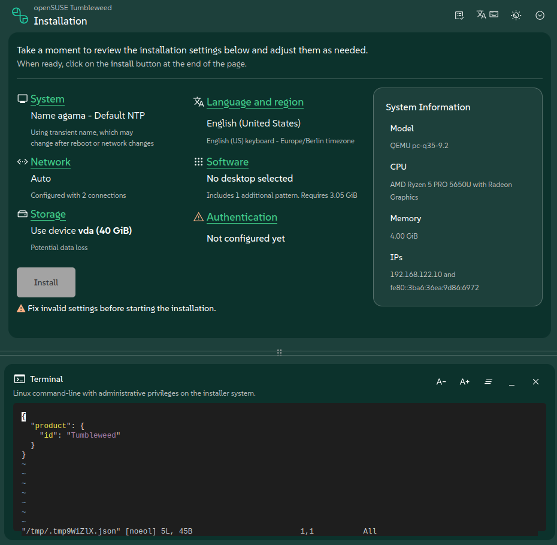
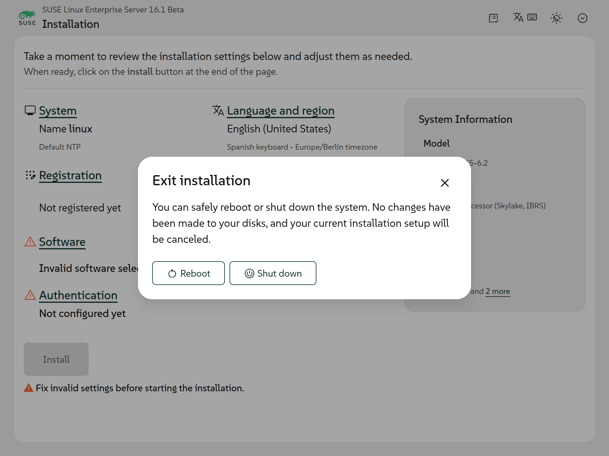
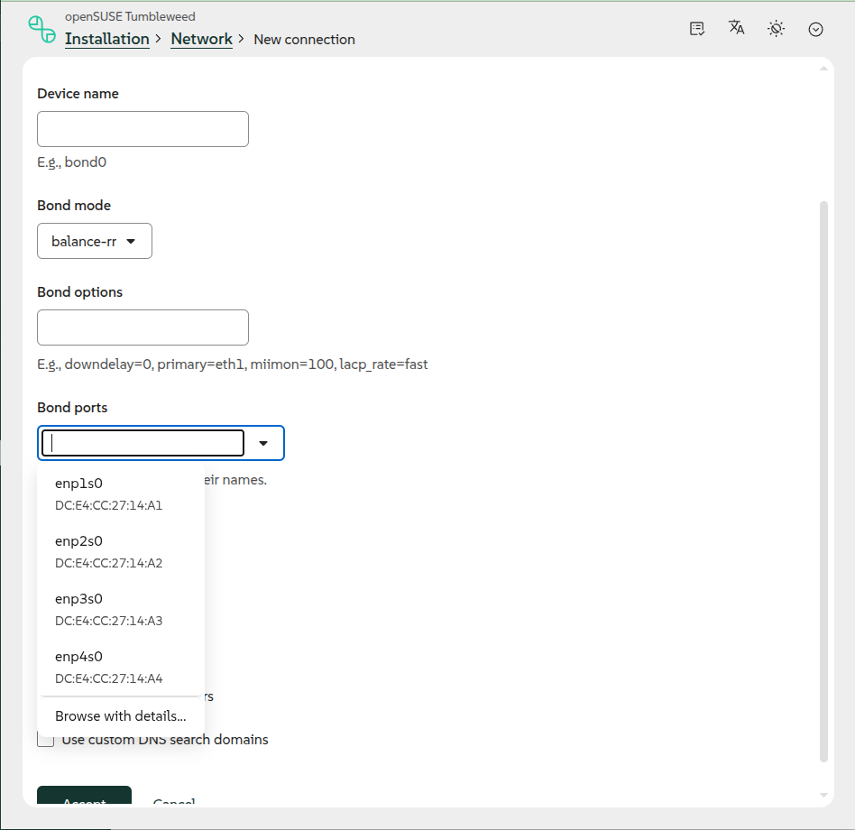
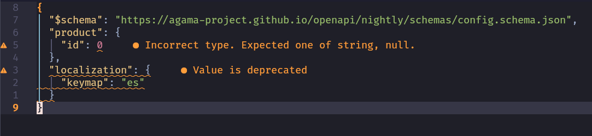

Agama 25 is here, and while it does not carry any single headline feature, it bundles a handful of
changes requested by users and some groundwork for what is coming next.

This is the first release after openSUSE Leap 16.1, starting the work toward Tumbleweed, Slowroll,
and Leap 16.2.

{/* truncate */}

Let's see what's new.

## A web-based terminal {#terminal}

Agama's web UI now features an actual terminal. Until now, if you needed a shell on the system you
were installing, your options were limited to switching to a different virtual console (e.g.
`Ctrl+Alt+F8`) if you had local access, or connecting through SSH.

Now you can just open a terminal from the comfort of Agama's web UI, without leaving the browser.

## Leaving before it's too late {#exit}

As several users requested, Agama now offers an exit option. You will find it from the very
beginning of the process, letting you reboot or shut down the machine if you change your mind.

It is important to note that the option is only available before the installation starts: cancelling
while Agama is already applying changes to the system could leave it in an unpredictable and
potentially unbootable state, so the exit option disappears as soon as the installation is underway.

## Enhanced port selection {#ports}

Until now, the ports of a bond or a bridge had to be typed by hand in a free-text field, with only a
line listing the existing device names as a hint. A typo was silently accepted, and the field did
not scale well past a handful of NICs.

In Agama 25, the ports selection uses a searchable multi-select field instead: the devices found in
the system are offered in a list you can filter as you type, and a name can still be written out by
hand for a device that is not present in the system yet.

## Towards Tumbleweed adoption {#tumbleweed}

Behind the scenes, we keep working with the Tumbleweed maintainers to make Agama the installer for
the distribution. There is still no date for that to happen, but we are getting closer. Recent
examples of that effort are
[adjusting the registration support and 32-bit media build](https://github.com/agama-project/agama/pull/3861)
and [adding riscv64 support](https://github.com/agama-project/agama/issues/3867), the latter
contributed by Andreas Schwab.

## Cutting ties with YaST packages {#yast}

Agama was born on top of several YaST packages, reusing logic that was already there instead of
rewriting it from scratch. We are now reducing that reliance, bringing into Agama's own codebase
just the parts it actually needs instead of pulling in whole YaST modules. So far
[this effort covers the AutoYaST-related code](https://github.com/agama-project/agama/pull/4008),
and more areas will follow.

## Polishing and publishing our OpenAPI and JSON schemas {#openapi}

Agama exposes its HTTP API through an OpenAPI specification and validates its configuration and
profile files against JSON schemas. We have been polishing both and, more importantly, publishing
them with stable URLs at
[Agama's documentation site](https://agama-project.github.io/docs/user/reference/openapi).

Having them published this way is useful well beyond Agama itself: it allows other tools to generate
clients, validate requests, or simply let people browse the API without digging through the source
code. The JSON schemas are useful on their own too. For instance, adding a `"$schema"` key pointing
to the right schema at the top of your AutoYaST-like profile or configuration file is enough for
many editors to offer autocompletion and inline validation as you type.

## Keep in touch {#closing}

On top of all that, we have also been busy with a bunch of smaller fixes and improvements that did
not make it into this post, like reporting more details about network devices or setting
`systemd-boot` as the default bootloader for MicroOS.

As always, you can take a look at the [project at GitHub](https://github.com/agama-project/agama) or
drop by the `#yast` channel at [Libera.chat](https://libera.chat/) if you have questions, feedback
or just want to say hello.

Stay tuned!
